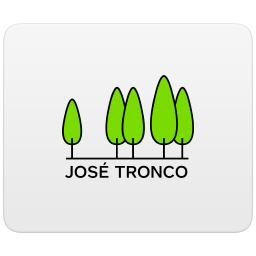

# 畅呼吸 · Changhuxi for Home Assistant



将已绑定到畅呼吸 App 的空气净化器接入 Home Assistant，支持通过 HomeKit Bridge 在 Apple「家庭」中控制。社区项目，非官方产品。

**已完成真实账号与设备验收。** 用户已在 HA 中使用手机号密码登录并发现净化器；原生集成的开关机、睡眠模式和50%手动速度均有设备回读确认。请查看 [发布记录](https://github.com/lisiimage/ha-changhuxi/releases) 了解版本和验证范围。

## 支持范围

- 已验证设备协议：畅呼吸 A3xx 产品族（产品 ID `160fa6b1b95b03e9160fa6b1b95b2401`）。目前只有一台实际设备验证，不承诺其他型号兼容。
- 电源、自动 / 手动 / 极速 / 睡眠、六档手动风速。
- PM2.5、温度、湿度；电机转速和故障代码诊断。
- 童锁、屏幕亮度设置。童锁与亮度的协议字段已还原，尚未分别进行所有值的实机验证。
- 一个账号选择多台净化器；一台离线不会隐藏其他在线设备。多设备支持有模拟测试，尚未多台实机验收。

**使用厂商云端，不是离线集成。** 不需要手机常开、不需要额外 Docker 服务，也不用手动提取 token。

## 安装

要求 Home Assistant **2026.7.4 或更新版本**。

### HACS 自定义仓库

本项目尚未进入 HACS 默认列表。可按以下方法安装：

1. 打开 HACS → 右上角菜单 → 自定义存储库。
2. 仓库输入 `https://github.com/lisiimage/ha-changhuxi`，类型选择 **Integration**。
3. 找到「畅呼吸 Changhuxi」并下载最新版本。
4. 重启 Home Assistant。
5. 设置 → 设备与服务 → 添加集成 → 搜索 **Changhuxi / 畅呼吸**。
6. 输入畅呼吸 App 使用的**手机号和密码**，选择账号下的净化器。

[一键打开 HACS 仓库添加页](https://my.home-assistant.io/redirect/hacs_repository/?owner=lisiimage&repository=ha-changhuxi&category=integration)

也可将 `custom_components/changhuxi` 复制到 HA 的 `config/custom_components/`，然后重启。

设备必须先在畅呼吸 App 中完成绑定；本集成不负责配网、注册账号或重置设备。目前确认的是手机号密码登录，未验证邮箱登录、微信/QQ登录或短信免密登录。

## 使用与 HomeKit

净化器添加后将出现一个风扇实体及相关传感器。`auto` / `manual` / `turbo` / `sleep` 对应自动 / 手动 / 极速 / 睡眠。

- 设置风速大于0会开机并切换到手动模式。百分比向上换算为六档；例如50%为三档，100%为六档。0%关机。
- 自动模式下不伪造“目标风速”；手动速度与真实电机转速是不同概念。
- 指令仅发送一次，读取设备反馈后更新界面。超时不盲目重发。
- 每30秒轮询。关机或传感器未就绪时，PM2.5显示未知，避免将无效值显示为0。

在已有 **HomeKit Bridge** 的配置中勾选净化器风扇与希望展示的传感器即可。默认以风扇配件提供电源和速度；四种预设模式在HA里选择。不要删除已配对的桥接。

账号下新增设备后，打开本集成的「配置」可重新发现并选择。登录失效时按 HA 的重新认证提示操作。

## 账号、隐私与限制

- 密码只用于本次HTTPS登录，不写入配置、日志或诊断。成功后，HA配置中保存服务端会话token与云端控制身份；请保护HA备份。
- 手机号按App的登录接口发送到 Smartisan；授权后从Xlink读取你已经绑定的设备。
- 登录请求使用HTTPS。净化器控制服务目前沿用App的**TCP 1883 MQTT**，控制链路不具备TLS保护。这是已验证的服务协议约束。
- 原App及其他同账号控制程序可能与本集成争用云端连接。日常请关闭原App；从旧网关迁移时停用旧网关及对应模板实体，避免重复设备和连接争用。
- 厂商服务停运、接口变化或账号风险验证可能影响使用。出现验证码时，配置界面会要求人工完成；不绕过验证。
- 诊断只包含设备数量和可用性，不包含手机号、token、设备MAC或ID。

App图标从用户提供的安卓安装包原样提取，且与该手机实际桌面图标一致。图标版权归原权利人，未授予MIT许可，详见 [NOTICE.md](NOTICE.md)。

## 开发和验证

```sh
python -m pip install -r requirements_test.txt
ruff check .
ruff format --check .
pytest -q
```

自动校验：33项单元测试、HACS Action、Hassfest。2026-10-22完成用户本人输入密码的登录、设备发现与原生控制验收；验证码、重新认证和多设备目前只有模拟测试，尚未逐项进行实机验证。

反馈问题请通过 GitHub Issues，不要上传HA `.storage`、密码、token、完整抓包或未经检查的日志。
